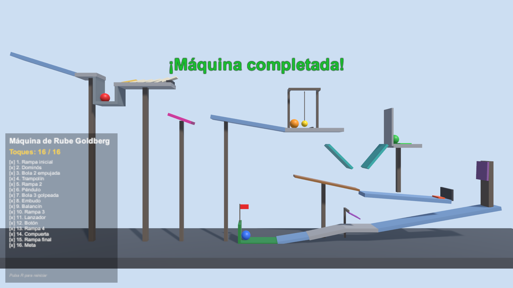
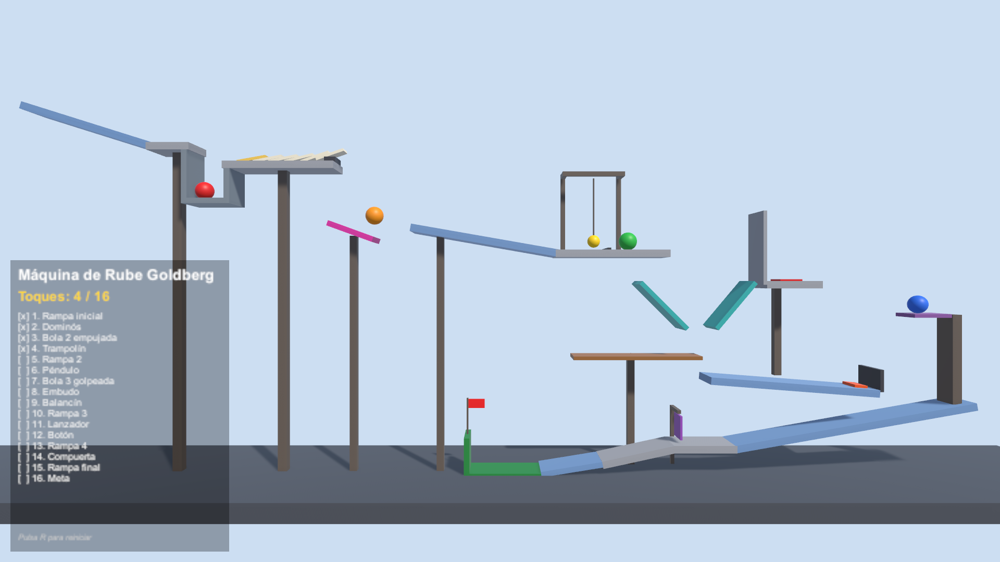
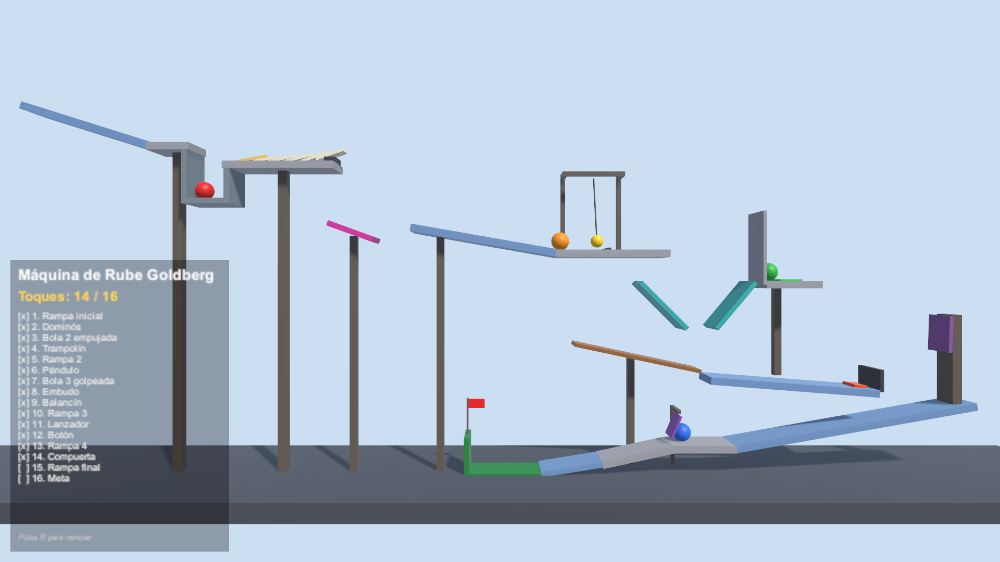

# Taller Unity: Máquina de Rube Goldberg

Taller del curso Desarrollo de Videojuegos. Es una máquina de Rube Goldberg hecha solo con el motor de
físicas de Unity: cuerpos rígidos (Rigidbody), colliders, materiales físicos, bisagras (HingeJoint) y
zonas trigger. La máquina encadena **16 toques** y termina sola en unos 25 segundos.



## Cómo ejecutarla

1. Abrir la carpeta del proyecto desde Unity Hub. Versión del editor: **6000.6.7f1** (plantilla Universal 3D, URP).
2. Abrir la escena `Assets/Scenes/RubeGoldberg.unity`.
3. Pulsar **Play**. El panel de abajo a la izquierda va marcando cada toque y al final aparece "¡Máquina completada!".
4. Con la tecla **R** se reinicia la escena.

## Los 16 toques

| # | Elemento | Qué pasa | Concepto de físicas |
|---|----------|----------|---------------------|
| 1 | Rampa inicial | La bola roja cae sobre la rampa y empieza a rodar | Rigidbody, gravedad, fricción |
| 2 | Dominós | La bola salta un hueco, golpea el primer dominó y rebota a la cubeta | Material físico con rebote |
| 3 | Bola 2 empujada | El último dominó empuja la bola naranja fuera de su pedestal | Transferencia de momento |
| 4 | Trampolín | La bola naranja cae en una tabla inclinada muy elástica y sale disparada | Bounciness (combinación Maximum) |
| 5 | Rampa 2 | Aterriza en la segunda rampa y baja rodando | Rodadura en pendiente |
| 6 | Péndulo | Choca con la bola de un péndulo y le pasa su velocidad | HingeJoint, choque elástico |
| 7 | Bola 3 golpeada | El péndulo golpea la bola verde | Colisión entre cuerpos dinámicos |
| 8 | Embudo | La bola verde cae en un embudo que la centra | Colliders inclinados |
| 9 | Balancín | Cae a la derecha del eje de un balancín y lo inclina | HingeJoint con límites, torque |
| 10 | Rampa 3 | El balancín la deja en la rampa 3 | Rodadura |
| 11 | Lanzador | Un trigger tipo resorte le fija una velocidad hacia arriba | Trigger y velocidad del Rigidbody |
| 12 | Botón | Cae sobre el botón y lo pulsa (se pone verde) | Trigger y evento entre scripts |
| 13 | Rampa 4 | El botón abre una trampilla; la bola azul cae a la rampa 4 | Rigidbody cinemático que pasa a dinámico |
| 14 | Compuerta | La bola azul empuja una compuerta que cuelga de una bisagra y pasa por debajo | HingeJoint con límites |
| 15 | Rampa final | Baja por la última rampa | Rodadura |
| 16 | Meta | Entra en la meta de la bandera | Trigger final |

## Scripts

| Script | Función |
|--------|---------|
| `Toque.cs` | Marca un elemento como toque de la cadena y lo registra la primera vez que lo golpea un objeto con física. |
| `ContadorToques.cs` | Lleva la cuenta de los toques y actualiza el panel y el mensaje final. |
| `Lanzador.cs` | Zona trigger que funciona como resorte: fija la velocidad del cuerpo que entra. |
| `Boton.cs` | Trigger que abre la trampilla y cambia de color al pulsarse. |
| `Trampilla.cs` | Trampilla con bisagra que pasa de cinemática a dinámica para abrirse. |
| `ReinicioEscena.cs` | Recarga la escena con la tecla R (Input System). |

Rampas, dominós, trampolín, péndulo, embudo, balancín y compuerta funcionan sin código: son solo
componentes de físicas configurados.

## Construcción y prueba

- La escena se puede volver a generar desde el menú **Taller > Construir escena Rube Goldberg** (`Assets/Editor/ConstructorEscena.cs`), que coloca todas las piezas por código.
- `Assets/Tests/PlayMode/PruebaMaquina.cs` es una prueba PlayMode que deja correr la máquina y comprueba que se completan los 16 toques. Se ejecuta en **Window > General > Test Runner > PlayMode**.
- En **Project Settings > Physics** está activado *Enhanced Determinism*, así la máquina se comporta igual en cada ejecución.

## Capturas

| | |
|---|---|
|  |  |
|  |  |
|  |  |
|  |  |

## Estructura

```
Assets/
  Editor/             ConstructorEscena.cs
  Materials/          Materiales de color de cada pieza
  PhysicsMaterials/   Rebote del dominó, del trampolín y del péndulo
  Scenes/             RubeGoldberg.unity
  Scripts/            Los 6 scripts de la tabla
  Tests/PlayMode/     Prueba de la máquina
Capturas/             Fotos de la máquina funcionando
```
